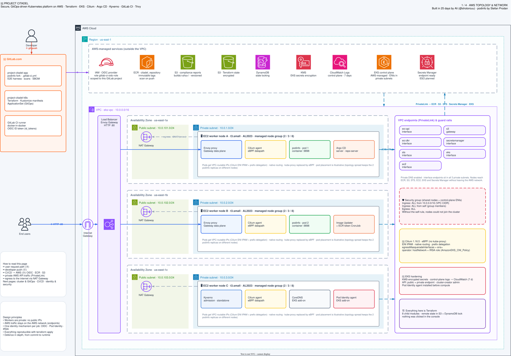
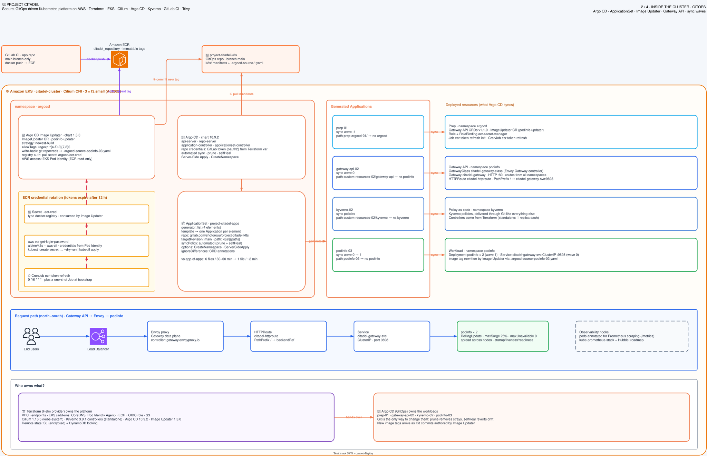
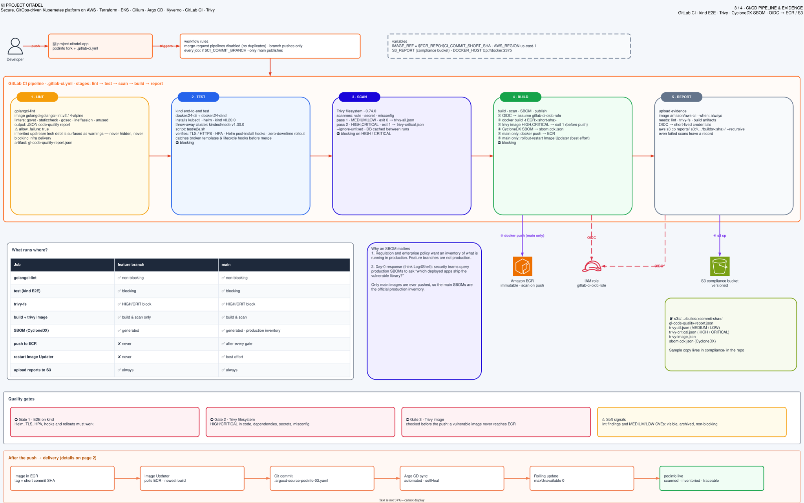
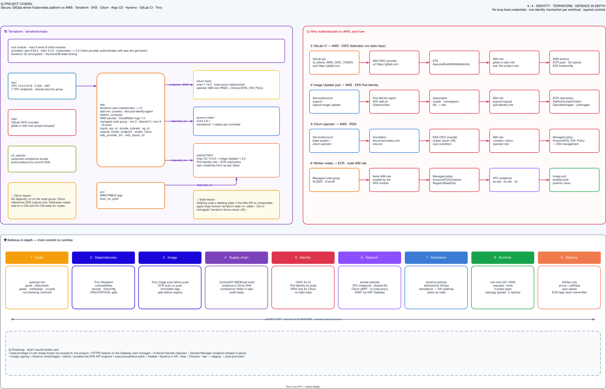
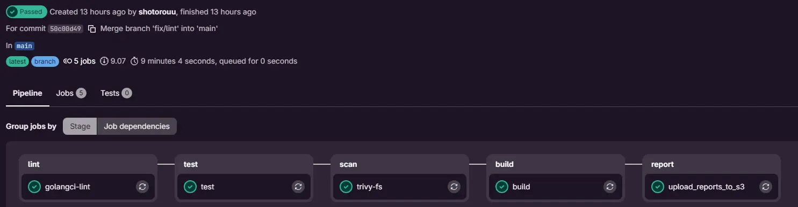
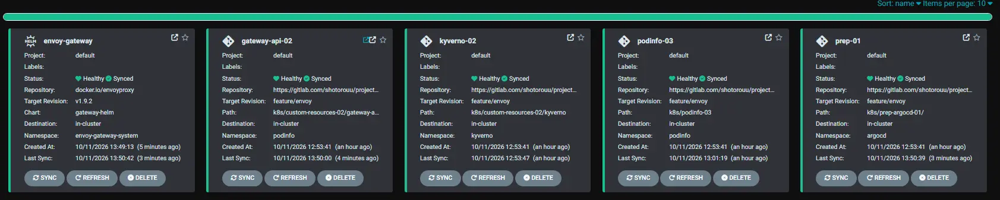
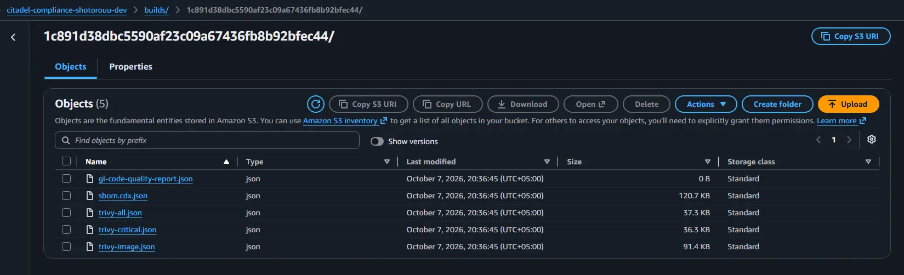

<div align="center">

# 🏰 Project Citadel

### Secure GitOps delivery on AWS EKS

*A solo DevOps learning project, built in ~28 days.*

I took one small, well-known Go service ([podinfo](https://github.com/stefanprodan/podinfo) by Stefan Prodan) and built everything a real production path needs around it: a private AWS network, an EKS cluster with eBPF networking, a security-gated CI pipeline, GitOps delivery with automated image promotion, and a compliance trail for every build.


</div>

---

# Architecture

[](./images/architecture-1-topology.svg)

*Click any diagram to open it full size.*

<details>
<summary><b>More diagrams:</b> cluster &amp; GitOps · CI/CD · identity &amp; security</summary>

### 2 · Cluster and GitOps
[](./images/architecture-2-gitops.svg)

### 3 · CI/CD pipeline
[](./images/architecture-3-cicd.svg)

### 4 · Identity and security
[](./images/architecture-4-identity.svg)

</details>

---

| Repository | Role |
|---|---|
| [`project-citadel-k8s`](https://github.com/shotorouu/project-citadel-k8s) **(this repo)** |  Terraform for AWS and EKS, plus the manifests Argo CD syncs (Kubernetes YAML, Kustomize overlays, Gateway API and Kyverno resources) |
| [`project-citadel-app`](https://github.com/shotorouu/project-citadel-app) | The podinfo fork and the CI pipeline |

> The two repositories never talk to each other. **ECR is the contract between them**: CI only pushes images, GitOps only watches for the new tags and deploys them.


# Highlights

| What | How |
|---|---|
| **Zero long-lived AWS keys, least privilege** | GitLab OIDC → two scoped IAM roles (image push trusts only `main`; report upload can only write `builds/*`), EKS Pod Identity for the Image Updater, IRSA for the Cilium operator |
| **Pipeline that says "no" early** | Trivy scans source and image *before* anything reaches the registry; fixable HIGH/CRITICAL findings fail the build |
| **Closed GitOps loop** | New image in ECR → Git commit → Argo CD sync → zero-downtime rollout. One ApplicationSet manages four Applications, and `selfHeal` reverts manual drift |
| **Policy as code** | Kyverno `ValidatingPolicy` (CEL) checks Deployments at admission, delivered through Git like every other manifest. Runs in Audit mode: reports violations without blocking |
| **Gateway API ingress** | `GatewayClass` → `Gateway` → `HTTPRoute` served by Envoy Gateway v1.9.2, installed and kept in sync by Argo CD, with an AWS load balancer created automatically from the Gateway |
| **eBPF networking** | Cilium replaces both kube-proxy and the VPC CNI (ENI mode, native routing) |
| **Audit evidence per build** | Trivy reports, lint report and CycloneDX SBOM stored in a versioned S3 bucket, even when the pipeline fails |
| **Everything as code** | 8 Terraform modules, remote state with locking, pinned chart versions, immutable ECR tags |


# The CI pipeline



| Stage | Job | What it does | Blocks? |
|---|---|---|---|
| lint | `golangci-lint` | Static analysis (`govet`, `staticcheck`, `gosec`, …) | Advisory |
| test | `test` | End-to-end tests on a throw-away [kind](https://kind.sigs.k8s.io/) cluster inside Docker-in-Docker | Yes |
| scan | `trivy-fs` | Vulnerabilities, secrets and misconfigurations in the repo | Fixable HIGH/CRITICAL |
| build | `build` | OIDC login, build, **scan image**, generate SBOM, push to ECR (`main` only) | Fixable HIGH/CRITICAL |
| report | `upload_reports_to_s3` | Upload all evidence to `builds/<commit-sha>/`, `when: always` | n/a |

# GitOps with Argo CD



One `ApplicationSet` (list generator) creates four Applications, and one of them installs a fifth. All use automated sync with `selfHeal` and `prune`, so Git stays the source of truth and manual changes in the cluster are reverted.

| Application | Path | Namespace | What it manages |
|---|---|---|---|
| `prep-01` | `k8s/prep-argocd-01` | `argocd` | Image Updater config, ECR token refresh (CronJob + RBAC), and the `envoy-gateway` Application |
| `envoy-gateway` | Helm chart `gateway-helm` v1.9.2 | `envoy-gateway-system` | Envoy Gateway controller, its Gateway API CRDs, and the proxy behind the load balancer |
| `gateway-api-02` | `k8s/custom-resources-02/gateway-api` | `podinfo` | `GatewayClass`, `Gateway`, `HTTPRoute` |
| `kyverno-02` | `k8s/custom-resources-02/kyverno` | `kyverno` | Kyverno policies (Audit mode) |
| `podinfo-03` | `k8s/podinfo-03` | `podinfo` | Deployment, Service, Kustomize image override |

- **Closed loop:** Argo CD Image Updater watches ECR, picks the newest build (`newest-build`), commits the new tag to Git, and Argo CD rolls it out with no downtime.
- **Ordering:** sync waves order resources inside an Application (Service in wave 0, then the Deployment in wave 1). The `01 / 02 / 03` prefixes only document the intended layering: Argo CD creates all four Applications at once and does not wait between them. `gateway-api-02` may therefore try to sync before Envoy Gateway's CRDs exist, so the ApplicationSet has a `retry` policy and the Application converges once the CRDs are there.

# Compliance



Every pipeline run uploads **up to five files** to `s3://<compliance-bucket>/builds/<commit-sha>/`. If an early gate fails (for example `trivy-fs`), the `build` stage never runs, so `trivy-image.json` and `sbom.cdx.json` are absent for that commit. The upload job still runs (`when: always`) and uploads whatever exists.

| File | Produced by | What it tells you |
|---|---|---|
| [`trivy-critical.json`](./reports/trivy-critical.json) | `trivy-fs` (the gate) | Result of the HIGH/CRITICAL scan, the one that decides pass or fail. No findings means a clean gate |
| [`trivy-all.json`](./reports/trivy-all.json) | `trivy-fs` (report only) | MEDIUM and LOW findings in dependencies, secrets and configuration: visible, but not blocking |
| [`trivy-image.json`](./reports/trivy-image.json) | `build` | Vulnerabilities in the final container image (OS packages and Go modules) |
| [`sbom.cdx.json`](./reports/sbom.cdx.json) | `build` | CycloneDX SBOM: the full ingredient list of the image |
| [`gl-code-quality-report.json`](./reports/gl-code-quality-report.json) | `golangci-lint` | Static analysis findings from the five linters |

> The same files are browsable in the [`reports/`](./reports) directory.

# Infrastructure highlights

- **Network:** `10.0.0.0/16` over 3 AZs, private nodes with no public IPs, NAT for egress, VPC endpoints (ECR, S3, STS, EKS, EC2, Secrets Manager) so AWS API traffic stays on the AWS network.
- **EKS:** `terraform-aws-modules/eks ~> 21.0`, AL2023 managed node group, KMS-encrypted secrets, access entries instead of `aws-auth`, Pod Identity Agent installed *before* compute.
- **Cilium:** `kubeProxyReplacement`, ENI IPAM, native routing, prefix delegation.
- **ECR auth without static keys:** ECR tokens expire after 12 hours and the Image Updater can't mint them itself. A small CronJob (Pod Identity, every 6h) refreshes a Secret the Image Updater uses as its registry credential.
- **Hardened workload:** 3 replicas, `maxUnavailable: 0`, topology spread, non-root user, resource limits, liveness/readiness/startup probes.
- **Policy as code:** Kyverno is installed by Terraform, so its CRDs exist before any policy. The policies live in Git (`k8s/custom-resources-02/kyverno/`) and are delivered by their own Argo CD Application. The first one, `deployment-audit-policy`, checks every Deployment on create/update and requires at least 3 replicas. It runs in `Audit` mode, so violations are reported rather than blocked.
- **Ingress:** Gateway API with Envoy Gateway v1.9.2, installed as an Argo CD Application (Helm, server-side apply). The chart also provides the Gateway API CRDs. `GatewayClass` → `Gateway` (HTTP :80) → `HTTPRoute` (`/` → podinfo Service on port 9898). The Gateway creates an AWS Classic Load Balancer in the public subnets.
- **GitOps layout:** one ApplicationSet with a list generator creates `prep-01`, `gateway-api-02`, `kyverno-02` and `podinfo-03`. `prep-01` also deploys the `envoy-gateway` Application (app-of-apps style). Applications are not ordered against each other, so `gateway-api-02` relies on retries until the Envoy CRDs are installed.


# Where it fought back

These are the problems that cost me the most time. Each is written as cause and solution because writing it down was how I made sure I really understood it.

| Topic | Root Cause & Deep Technical Detail | Solution |
| --- | --- | --- |
| **Low-Level Egress NAT Failure** *(Networking / CNI)* | AWS Nitro instances running AL2023 name interfaces `ens5`/`ens6` instead of legacy `eth+`. Cilium failed to match egress interfaces, silently skipping SNAT and causing raw pod packets to drop at the NAT gateway. | Configured `egressMasqueradeInterfaces = "ens+"` to apply masquerading cleanly across all `ens` interfaces. |
| **ECR Token Lifecycle Bridge** *(IAM / Identity)* | ECR tokens expire after 12 hours, and Argo CD Image Updater lacks native IAM token minting support. Standard IRSA did not resolve the tool's token lifecycle requirements. | Paired EKS Pod Identity with an automated CronJob that mints short-lived ECR tokens and updates a native Kubernetes Secret. |
| **Terraform State Traps & Deadlocks** *(IaC / Engine)* | Deleting code caused Terraform to attempt `destroy` calls via an unreachable API (`127.0.0.1`), trapping state updates. A concurrent cancellation left an orphaned DynamoDB lock. | Purged phantom records using `terraform state rm <address>` and released the backend using `terraform force-unlock <LOCK-ID>`. |
| **CNI Bootstrapping Deadlock** *(Orchestration)* | A top-level `depends_on = [module.eks]` on Cilium created a circular wait: nodes needed a CNI to reach `Ready`, but the CNI waited on full node group completion. | Removed module-level `depends_on` and passed direct cluster output attributes into the Cilium module. |
| **GitOps Scalability Shift** *(Architecture)* | The App-of-Apps pattern required maintaining duplicate Application manifests per service, introducing heavy maintenance overhead and sync typos. | Replaced individual app manifests with an Argo CD ApplicationSet using a list generator (reducing onboarding to 3 lines). |
| **Tag Promotion Strategy** *(CI/CD / Delivery)* | `semver` tag sorting orders numerically (breaking git commit SHAs) and `latest` is deprecated in Image Updater. | Configured `newest-build` for deterministic, chronological image update tracking. |

# Deploy it yourself

Prerequisites: AWS credentials with admin rights for the first apply, `terraform`, `kubectl`, AWS CLI v2, and a GitLab token (`read_repository`, `write_repository`). Everything is hardcoded to `us-east-1`.

```bash
# 1. state backend (once): S3 bucket + DynamoDB lock table
cd terraform/bootstrap
terraform init && terraform apply

# 2. provision VPC, EKS, ECR, OIDC, Cilium, Kyverno, Argo CD (EKS alone takes ~10 min)
cd ../main
export TF_VAR_pat_token="glpat-xxxx"            # never commit this
terraform init && terraform apply

# 3. hand the cluster over to GitOps (the only manual apply, done once)
aws eks update-kubeconfig --region us-east-1 --name citadel-cluster
kubectl apply -f ../../k8s/applicationset.yml
```

4. **Run the CI pipeline on `main` of the app repo.** The ECR repository is empty after step 2, so the podinfo pods sit in `ImagePullBackOff` (the Kustomize default tag is `0000000`) until CI pushes the first image. The Image Updater then commits the real tag to `k8s/podinfo-03/.argocd-source-podinfo-03.yaml` and Argo CD rolls it out.
5. Check the result: `kubectl get gateway -n podinfo` shows the load balancer address.

**Using your own copies?** Account-specific values live in more places than the manifests. Change all of these:

| What | Where |
|---|---|
| Git repo URL | `k8s/applicationset.yml` (`repoURL`), `terraform/main/argocd-helm/main.tf` (`url`) |
| GitLab `project_id` | `terraform/main/oidc/main.tf` (both roles) |
| AWS account ID / ECR address | `image-updater.yml`, `cronjob-creds.yml`, `deployment.yml`, `kustomization.yaml`, `terraform/main/argocd-helm/image-updater.tf`, and `.gitlab-ci.yml` in the app repo (`ECR_REGISTRY`, `ECR_REPO`, both role ARNs) |
| S3 bucket names (globally unique) | `terraform/bootstrap/bootstrap_s3_db.tf`, the `backend "s3"` block in `terraform/main/provider.tf`, `terraform/main/s3_reports/variables.tf` and `S3_REPORT` in `.gitlab-ci.yml` |
| Generated file | delete `k8s/podinfo-03/.argocd-source-podinfo-03.yaml`; the Image Updater recreates it |


# Cost and teardown

The expensive parts are the EKS control plane, the NAT gateways, the interface VPC endpoints and the load balancer, which all bill by the hour whether or not traffic flows. Building this cost me ~150$ over 28 days, and I only kept the stack up while working on it. **Destroy it when you are done.**

```bash
# 1. stop Argo CD from recreating things, then remove the Gateway and its AWS load balancer
kubectl delete applicationset -n argocd --all
kubectl delete gateway -A --all
#    check in EC2 → Load Balancers that the ELB is really gone
# 2. empty the ECR repository (Terraform cannot delete one that holds images)
# 3. copy out any reports you want to keep (the evidence bucket is force_destroy)
# 4. then:
terraform destroy
```

> Or you can also use cloud-nuke (It deletes everything in the account)

# Credits

### Documentation and learning material that I used

- [Argo CD](https://argo-cd.readthedocs.io/) and [Argo CD Image Updater](https://argocd-image-updater.readthedocs.io/) docs
- [Cilium docs](https://docs.cilium.io/), especially the Helm Reference
- [Kyverno docs](https://kyverno.io/docs/)
- [Gateway API](https://gateway-api.sigs.k8s.io/)
- [Trivy](https://trivy.dev/) and the [CycloneDX](https://cyclonedx.org/) specification
- [Trivy walkthrough video](https://www.youtube.com/watch?v=q3XMP34IGVQ) that got me started with Trivy
- [GitLab: OIDC with AWS](https://docs.gitlab.com/ci/cloud_services/aws/)
- [Amazon EKS Pod Identity](https://docs.aws.amazon.com/eks/latest/userguide/pod-identities.html)
- [Terraform Registry](https://registry.terraform.io) 
- [Envoy Gateway](https://gateway.envoyproxy.io/docs/)
	
The application, **podinfo**, is by [Stefan Prodan](https://github.com/stefanprodan) and contributors (Apache-2.0).

Built by **Ali** ([@shotorouu](https://github.com/shotorouu)). If you spot something I could do better, open an issue or a merge request, feedback is very welcome!
